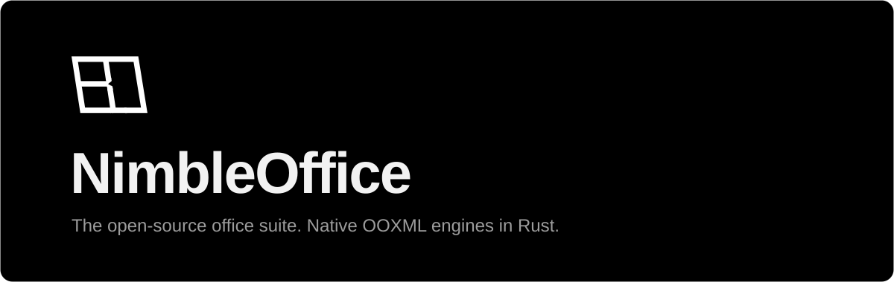

<p align="center">
    
  </a>
</p>

<p align="center">
  Rust-native OOXML engines with collaboration and agent editing at the core.<br>
  WebAssembly for browsers. Headless APIs for servers. Native Rust where you need it.
</p>

<p align="center">
</p>

## Features

- **Documents, spreadsheets, and slides.** Open, edit, render, and save DOCX,
  XLSX and PPTX files with high fidelity. Native OOXML editing preserves untouched
  file parts losslessly when round-tripping.

- **Agent editing with human review.** Review attributed agent edits through
  tracked changes, inline diffs, and before-and-after previews. Accept or
  reject DOCX proposals in the optional proposal sidebar.

- **Real-time collaboration.** People and agents edit the same file together,
  with live cursors and selections. Concurrent changes merge automatically,
  and offline edits sync when peers reconnect.

- **Undo and redo.** Navigate editing history and undo accepted agent
  proposals as a single step.

- **Embed or automate.** Drop React editors into your app, build on the
  framework-free JavaScript cores, or use Rust and Python APIs for headless
  processing and agent workflows.

- **Open source and self-hostable.** Apache-2.0 licensed, with control over
  your document storage, deployment, and collaboration infrastructure.

Try it out, or
explore the docs for setup, APIs, and format support.

## Packages

| | Rust | Core | Core (native) | React | Python |
|---|---|---|---|---|---|
| DOCX | `nimbleoffice-docx` | `docx` | `docx-native` | `docx-react` | `nimbleoffice-docx` |
| XLSX | `nimbleoffice-xlsx` | `xlsx` | `xlsx-native` | `xlsx-react` | `nimbleoffice-xlsx` |
| PPTX | `nimbleoffice-pptx` | `pptx` | `pptx-native` | `pptx-react` | `nimbleoffice-pptx` |

**Rust:** typed engine API. **Core:** `@nimbleoffice/<format>`, the framework-free core through WebAssembly. **Core (native):** the same engine as prebuilt native bindings for Node.js, Bun and Deno on macOS, Linux and Windows. **React:** drop-in editor. **Python:** read, edit, render, save.

More packages:

- **Agent tools:** `@nimbleoffice/agents`, the TypeScript SDK and `nimbleoffice-mcp` server.
- **Fonts:** `@nimbleoffice/fonts`, `@nimbleoffice/fonts-cjk`, `@nimbleoffice/fonts-intl`, `@nimbleoffice/fonts-latin`.
- **i18n:** `@nimbleoffice/docx-i18n`, `@nimbleoffice/xlsx-i18n`, `@nimbleoffice/pptx-i18n`.

What to install for which language, with a first example each:
npm,
crates.io,
PyPI.

Upgrading from 0.4? See Migrating to 0.5.

## Fonts

Layout needs the fonts a document names. NimbleOffice ships open substitutes with the same
advance widths as the Microsoft core fonts (Carlito for Calibri, Caladea for Cambria, Liberation
Sans, Serif and Mono for Arial, Times New Roman and Courier New) plus script coverage, so line
breaks and pagination match Office without the original fonts installed. DOCX layout resolves a
face in this order: fonts embedded in the document, fonts your app configures, the bundled packs,
then a last resort fallback.

| Pack | Covers | Size |
|---|---|---|
| `@nimbleoffice/fonts-latin` | Office core families, common presentation families, Hebrew and Arabic | 4.6 MB |
| `@nimbleoffice/fonts-intl` | 23 more scripts, among them Thai, Devanagari and other Indic scripts, Armenian, Georgian and Ethiopic | 2.2 MB |
| `@nimbleoffice/fonts-cjk` | Simplified and Traditional Chinese, Japanese, Korean | 26.7 MB |

**Node.js, Bun and Deno.** `@nimbleoffice/docx` and `@nimbleoffice/pptx` depend on the font
manager `@nimbleoffice/fonts`, which installs
`fonts-latin`. Add `fonts-intl` or `fonts-cjk` to cover those scripts. DOCX reads each face from the
installed package files the first time a document needs it; nothing is downloaded. Reading package
files needs Node.js 20.16 or 22.3 and later, Bun or Deno.

**Native bindings, Rust and Python.** The Rust format crates bundle all three packs by default and
resolve faces in the same order, with nothing fetched; see the
Rust guide to leave packs out or load them from your own
location. `@nimbleoffice/pptx-native` and `@nimbleoffice/xlsx-native` install the npm packs and read
each face from disk; `@nimbleoffice/docx-native` uses the same font manager as `@nimbleoffice/docx`. For Python, register
the faces a document needs before rendering.

<!-- BEGIN GENERATED VISUAL FIDELITY -->
## Structure

- `crates/`: the Rust engines
- `packages/`: the TypeScript editor packages
- `bindings/`: the Python bindings
- `e2e/`: browser tests
- `fixtures/demo/`: sample documents and collaboration seeds used by tests

## Development

```bash
bun install
bun run rust:check   # fmt + clippy + tests for the engines
```

Run `bun run test:e2e:browser` for headless browser tests of all three editors.

## Contributing

Contributions are welcome.

## License

[Apache-2.0](LICENSE). Third-party attribution in [THIRD-PARTY-NOTICES.md](THIRD-PARTY-NOTICES.md).

NimbleOffice is a modified version of [BetterOffice](https://github.com/openooxml/betteroffice) (Apache-2.0, © 2026 Elia Hilse, The OpenOOXML Project). It is not affiliated with or endorsed by the BetterOffice project.
